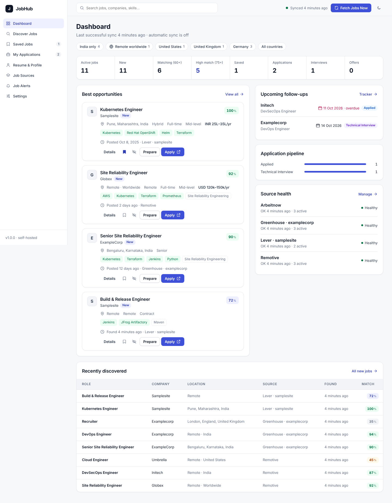
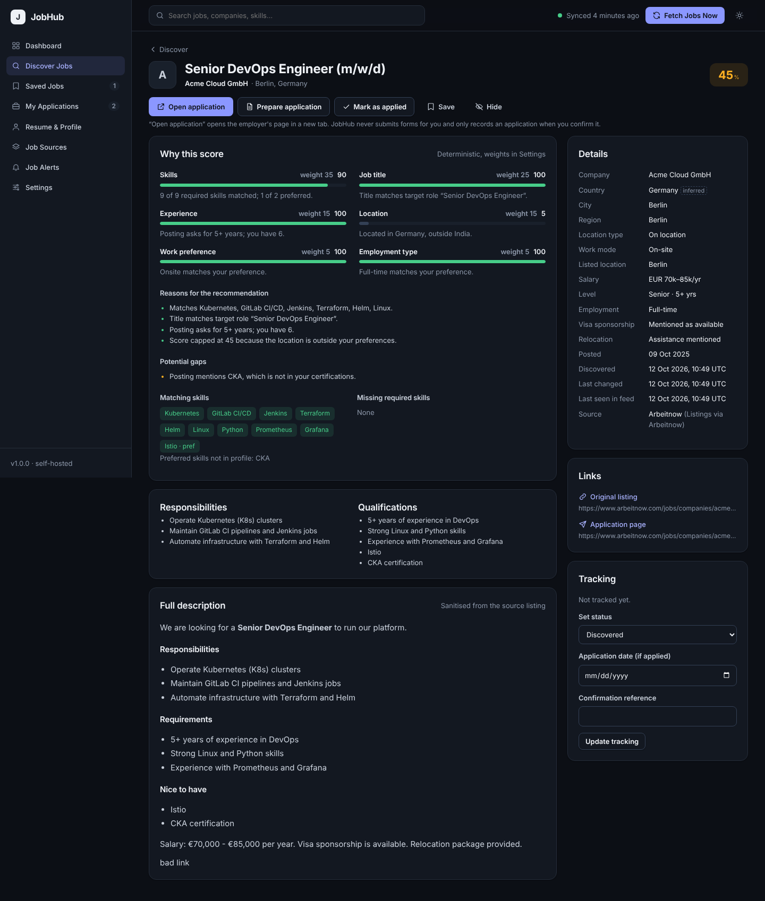
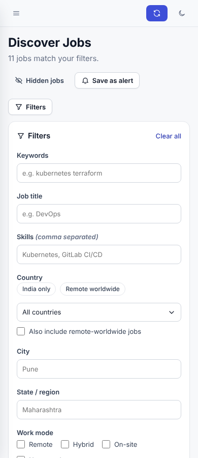

# JobHub

A self-hosted, local-first platform that finds jobs from public job APIs, scores each one against your saved profile, and tracks every application from discovery to offer.

- **Single container**: FastAPI, SQLite in WAL mode, and one in-process background scheduler. No Redis, no message queue, no JavaScript framework.
- **No paid services**: matching, cover-letter drafts and resume parsing all run locally and deterministically.
- **Private by default**: the app binds to `127.0.0.1`, runs as a non-root user with a read-only root filesystem, and never serves resumes publicly.

Contents: [Features](#features) · [Architecture](#architecture) · [Job sources](#job-sources) · [Install on Ubuntu](#install-on-ubuntu) · [Operations](#day-to-day-operations) · [Backup & restore](#backup--restore) · [Configuration](#configuration) · [Security](#security) · [Testing](#testing) · [Limitations](#known-limitations) · [Troubleshooting](docs/TROUBLESHOOTING.md)

| Dashboard (light) | Job details (dark) | Discover (mobile) |
|---|---|---|
|  |  |  |

<sub>The screenshots use the fictional companies from the test fixtures. A real installation only shows jobs fetched from your configured sources.</sub>

---

## Features

| Area | What you get |
|---|---|
| **Dashboard** | Counts taken from the database (active, new, matching, high-match, saved, applied, interviews, offers), best opportunities, recently discovered jobs, follow-ups due, application pipeline, source health, last and next sync, a "Fetch Jobs Now" button, and quick country filters. |
| **Automatic discovery** | A background scheduler with a configurable interval and fetch-on-startup. Live progress shows fetched, added, updated, skipped and expired counts. Each source fails independently, temporary errors are retried with bounded backoff, runs can't overlap, and listings are deduplicated. |
| **Country filtering** | All 249 ISO 3166-1 countries in a searchable multi-select, with shortcuts such as "India only" and "Remote worldwide". You can filter by region and city. JobHub separates on-site jobs, country-restricted remote, region-restricted remote, worldwide remote and unknown-location jobs. A country is never invented: one inferred from a well-known city is labelled *inferred*. |
| **Advanced search** | Filters for keywords, title, skills, country, city, region, work mode, location type, salary range and currency, experience level and years, employment type, company, source, posting date, visa, relocation, minimum score, saved, unapplied and new. Results can be sorted six ways and are paginated. Filters persist between visits, and **Clear all** resets them. |
| **Profile & resume** | A manual editor plus PDF/DOCX/TXT upload. Extracted data is shown as suggestions you merge selectively; nothing is overwritten automatically. |
| **Explainable matching** | Six weighted components: skills, title, experience, location, work mode and employment type. Skill aliases are normalised (K8s → Kubernetes, GitLab pipelines → GitLab CI/CD). Each job shows its strong skills, missing required skills, gaps and reasons. Weights are adjustable in Settings. |
| **Apply workflow** | The application URL is validated before it opens. **Open application**, **Prepare application** and **Mark as applied** are separate actions, and opening a page never counts as applying. Each job gets one tracking record. |
| **Preparation** | Template-based drafts: cover letter, summary, skill highlights, common-question answers and notes. Everything is editable and clearly labelled as a draft. Drafts can be copied or downloaded as `.txt` or `.docx`. Nothing outside your profile is claimed; unknowns are left as `[placeholders]`. |
| **Tracker** | 14 statuses with status groups, search, sort, pagination, history and follow-up reminders. Export to CSV is protected against formula injection. Records survive when a listing expires. |
| **Alerts** | Saved searches re-evaluated after each sync. New matches appear on the page and as a sidebar badge. Alerts are in-app only; there is no email. |
| **Settings** | Sync interval, limits, retention, matching weights, light/dark/system theme, one-click online backup and backup download. |

## Architecture

```
┌──────────────────────────── jobhub container (1 process) ───────────────────────────┐
│  uvicorn (1 worker)                                                                  │
│   ├─ FastAPI routes + Jinja2 server-rendered pages + ~10 KB vanilla JS               │
│   ├─ SecurityMiddleware (same-origin POST check, optional Basic auth, CSP headers)   │
│   └─ Scheduler thread (flock: one per data dir) ──► sync engine ──► source adapters  │
│                                                       │            (httpx, allow-    │
│                                                       │             listed hosts)    │
│  SQLite /data/jobhub.db  ◄── short write txns (BEGIN IMMEDIATE, serialised) ─┘       │
│  /data/uploads (resumes, 0600)   /data/backups (online backups)                      │
└──────────────────────────────────────────────────────────────────────────────────────┘
```

| Path | Responsibility |
|---|---|
| `app/config.py` | Environment configuration, validated at startup |
| `app/db.py` | Engine and pragmas (WAL, `busy_timeout`, foreign keys), read and write sessions |
| `app/migrations.py` | Versioned, idempotent migrations under a file lock, with a pre-migration backup |
| `app/models.py` | ORM models: jobs, job_countries, sources, applications (+events), preparations, profile, resumes, alerts, sync_runs, settings |
| `app/sources/` | Adapter interface (`base.py`) plus the Arbeitnow, Remotive, Greenhouse and Lever adapters, and search links for unsupported sites |
| `app/sync.py` | Fetch → upsert → expire → score, with overlap locking |
| `app/scheduler.py` | The single background scheduler |
| `app/geo.py` | ISO country data and conservative location normalisation |
| `app/skills.py`, `app/matching.py` | Skill taxonomy and aliases; the deterministic scoring engine |
| `app/search.py` | Query-string filters translated into indexed SQL |
| `app/prepare.py` | Offline application-material drafts |
| `app/resume.py` | Upload validation and text extraction |
| `app/web/` | Routes |
| `app/templates/`, `app/static/` | UI |

**SQLite reliability.** Readers never block the writer, thanks to WAL. Every write goes through one serialised code path that opens `BEGIN IMMEDIATE`, which avoids the read-to-write lock-upgrade deadlock. `busy_timeout=30s` covers external writers such as the backup CLI. Network I/O never happens inside a transaction, and sync writes happen in batches of 100. WAL alone does not prevent `database is locked`; these measures together do, for the supported single-process deployment. Run exactly one JobHub process per database; the scheduler and migrations enforce this with file locks.

## Job sources

Every integration below uses an official, documented, unauthenticated public endpoint. JobHub only reads published listings and never submits applications.

| Source | Endpoint | Credentials | Notes |
|---|---|---|---|
| **Arbeitnow** | `GET https://www.arbeitnow.com/api/job-board-api?page=N` | None | Mostly Europe/Germany plus remote. Paginated via `links.next`. |
| **Remotive** | `GET https://remotive.com/api/remote-jobs` ([docs](https://github.com/remotive-com/remote-jobs-api)) | None | Remote only. Per Remotive's terms, JobHub limits this source to one fetch every 6 hours (at most 4 a day) and links back to Remotive with attribution. Listings are delayed 24 hours by Remotive. |
| **Greenhouse** (per company) | `GET https://boards-api.greenhouse.io/v1/boards/{token}/jobs?content=true` ([docs](https://developers.greenhouse.io/job-board.html)) | None | Returns all published jobs in one response, so a missing job is reliably marked expired. |
| **Lever** (per company) | `GET https://api.lever.co/v0/postings/{site}?mode=json&skip=&limit=` ([docs](https://github.com/lever/postings-api)), EU: `api.eu.lever.co` | None | Paginated. Uses `workplaceType`, `country` and `salaryRange` when present. |

**Unsupported sites (link only):** LinkedIn, Naukri, Indeed, foundit and Glassdoor offer no API that individuals may use, and their terms prohibit scraping. JobHub does **not** access them. The profile page provides links to each site's own search page, prefilled with your target titles and cities, and you can add roles you find there to the tracker manually.

**Adding a company board:** on the **Job Sources** page, choose Greenhouse or Lever and paste the company's careers URL or board identifier, or set `JOBHUB_GREENHOUSE_BOARDS` / `JOBHUB_LEVER_SITES` in `.env`. Before relying on a company, check that it actually uses that platform; a wrong identifier shows up as an `HTTP 404` source error.

**Adding a new adapter:** subclass `SourceAdapter` in `app/sources/`, set `allowed_hosts`, implement `fetch()` to return `NormalizedJob`s via `build_job()`, and register the class in `app/sources/__init__.py`. Storage, deduplication, change detection, expiry and scoring are handled by the core.

**Evidence status of the endpoint contracts:**

- **Lever and Remotive** (direct evidence): field names and terms were checked against each vendor's official README.
- **Greenhouse and Arbeitnow** (indirect evidence): the field contracts come from secondary sources and long-standing public usage.
- **Live verification:** none of the APIs could be called from the build sandbox because of network restrictions. All adapters are covered by automated tests against fixtures that mirror the documented response shapes. They have not been exercised against the live services, so check **Job Sources** after your first sync.

## Install on Ubuntu

Requirements: Ubuntu 22.04 or 24.04, Docker Engine 24 or newer, and the Compose plugin v2.24 or newer. About 200 MB of disk for the image and 256 MB of RAM.

```bash
# 1. Check Docker (install: https://docs.docker.com/engine/install/ubuntu/)
docker --version
docker compose version
sudo systemctl status docker --no-pager

# 2. Get the code (or unzip the release archive)
git clone <your-repo-url> jobhub && cd jobhub      # or: unzip jobhub.zip && cd jobhub

# 3. Configure (never overwrites an existing .env)
[ -f .env ] || cp .env.example .env
nano .env                                          # optional: add Greenhouse/Lever boards, etc.

# 4. Build and start
docker compose build
docker compose up -d

# 5. Open the UI
xdg-open http://127.0.0.1:8080 || echo "Open http://127.0.0.1:8080"
```

On first start JobHub creates the database in the Docker volume `jobhub-data`, seeds your initial profile, and (with `JOBHUB_FETCH_ON_STARTUP=true`) starts the first sync in the background.

### Air-gapped or proxied builds

```bash
# Use an internal registry for the base image and an internal PyPI mirror
docker compose build \
  --build-arg PYTHON_IMAGE=registry.internal/library/python:3.12-slim \
  --build-arg PIP_INDEX_URL=https://nexus.internal/repository/pypi/simple

# TLS-intercepting proxy: pass its CA as a build secret (it is not stored in the image)
docker build --secret id=ca_bundle,src=/etc/ssl/certs/corp-ca.pem -t jobhub:latest --target runtime .

# Move a built image to an offline host
docker save jobhub:latest | gzip > jobhub-image.tar.gz      # on the connected host
docker load < jobhub-image.tar.gz                           # on the offline host
```

At runtime, outbound requests honour `HTTPS_PROXY`, `NO_PROXY` and `SSL_CERT_FILE`, so add them to `.env` if needed. In a fully offline environment, job discovery cannot reach the public APIs. Every other feature still works, including the tracker, profile, preparation and manually added applications.

## Day-to-day operations

```bash
docker compose ps                         # container status + health
docker compose logs -f --tail=200 jobhub  # logs (rotated: 3 x 10 MB)
docker compose restart jobhub             # restart
docker compose stop jobhub                # stop (graceful; finishes the current DB write)
docker compose up -d                      # start again

# One-off commands inside the container
docker compose exec jobhub python -m app.cli check-config
docker compose exec jobhub python -m app.cli sync            # run a sync now (CLI)
docker compose exec jobhub python -m app.cli list-backups
```

**Updating JobHub.** Data lives in the named volume and survives rebuilds:

```bash
docker compose exec jobhub python -m app.cli backup --label pre-update
git pull                                  # or unpack the new release over the old directory
docker compose build
docker compose up -d                      # migrations run automatically, after an automatic pre-migration backup
```

Never run `docker compose down -v`: the `-v` flag deletes the data volume.

## Backup & restore

Backups use SQLite's online backup API, so they are consistent while the app is running. They are written to `/data/backups` inside the volume.

```bash
# Create a backup (also available on Settings → "Create backup now")
docker compose exec jobhub python -m app.cli backup

# Copy backups to the host
mkdir -p ./backups && docker compose cp jobhub:/data/backups/. ./backups/

# Full copy of the volume (database + resumes + backups) using the JobHub image itself
docker run --rm --user 0 --entrypoint tar -v jobhub-data:/data:ro -v "$PWD":/out jobhub:latest \
  czf /out/jobhub-volume-$(date +%F).tgz -C /data .
```

Restoring replaces the live database, so it is deliberately CLI-only and requires the app to be stopped. A safety copy of the current database is made first.

```bash
# A backup that is already inside the volume
docker compose stop jobhub
docker compose run --rm --no-deps jobhub python -m app.cli list-backups
docker compose run --rm --no-deps jobhub python -m app.cli restore jobhub-YYYYMMDD-HHMMSS-cli.db --yes
docker compose up -d

# A backup file on the host
docker compose stop jobhub
docker compose run --rm --no-deps -v "$(realpath ./backups/jobhub-....db)":/restore/backup.db:ro \
  jobhub python -m app.cli restore /restore/backup.db --yes
docker compose up -d
```

`scripts/backup.sh` (backup and copy to `./backups/`) and `scripts/restore.sh <file>` (stop, restore, start) wrap these commands. The restore refuses to run while JobHub is running and always verifies the backup's integrity first.

## Configuration

All settings live in `.env`; see [`.env.example`](.env.example) for every variable with its range. Invalid values stop startup with a clear message. The most important ones:

| Variable | Default | Purpose |
|---|---|---|
| `JOBHUB_HOST` / `JOBHUB_PORT` | `127.0.0.1` / `8080` | Host address and port the UI is published on |
| `JOBHUB_ALLOWED_HOSTS` | `127.0.0.1,localhost` | Accepted `Host` headers (DNS-rebinding protection) |
| `JOBHUB_SYNC_INTERVAL_HOURS` | `6` | Background sync interval (also editable in Settings) |
| `JOBHUB_FETCH_ON_STARTUP` | `true` | Run the first sync automatically |
| `JOBHUB_MAX_JOBS_PER_SOURCE` | `500` | Upper bound per source per run |
| `JOBHUB_REQUEST_TIMEOUT_SECONDS` | `20` | Timeout for each HTTP request |
| `JOBHUB_GREENHOUSE_BOARDS`, `JOBHUB_LEVER_SITES`, `JOBHUB_LEVER_EU_SITES` | empty | Company boards to register |
| `JOBHUB_AUTH_USER` / `JOBHUB_AUTH_PASSWORD` | empty | Optional HTTP Basic auth |
| `JOBHUB_LOG_LEVEL` | `INFO` | Log verbosity |

Settings saved in the UI (interval, limits, weights) are stored in the database and take precedence over the environment defaults.

## Security

- **Bound to `127.0.0.1` by default.** The compose port mapping publishes on localhost only.
- **CSRF protection.** State-changing requests must come from the same origin (checked via `Origin`/`Referer`), so other websites open in your browser cannot trigger actions.
- **DNS-rebinding protection.** Requests are rejected unless their `Host` header is in `JOBHUB_ALLOWED_HOSTS`.
- **Response headers.** A strict CSP (no inline scripts or styles), plus `X-Frame-Options: DENY`, `nosniff`, a same-origin referrer policy and a restrictive Permissions-Policy.
- **SSRF protection.** Adapters only call HTTPS hosts on their own allow-list. Board identifiers are validated against `[A-Za-z0-9_.-]`. Redirects are re-checked against the allow-list, and DNS results must be public IPs (127.0.0.0/8, RFC 1918, link-local and cloud-metadata addresses are refused).
- **External content.** Job descriptions are sanitised with an allow-list (nh3/ammonia), so scripts, event handlers, iframes and `javascript:` URLs are removed. External links get `rel="noopener noreferrer"`. Application URLs must be valid http(s) URLs pointing at public hosts before JobHub redirects to them.
- **Uploads.** Files are checked for extension, content signature (PDF magic, DOCX zip structure with zip-bomb limits, TXT without NUL bytes) and size limit. They are stored under random names with mode `0600` and are never served statically; downloads are attachments. Path traversal is blocked.
- **Database.** All queries go through the SQLAlchemy ORM or bound parameters, and `LIKE` wildcards are escaped.
- **Destructive operations.** Restore is CLI-only, deleting an application requires typing `DELETE`, sources with stored jobs can only be disabled, and the database is never recreated automatically.
- **Container.** The container runs as a non-root user (uid 10001) with a read-only root filesystem, all capabilities dropped and `no-new-privileges`. Memory and CPU are limited.
- **Secrets.** Secrets come only from environment variables; none are in the source code.
- **Privacy.** Personal data stays on this machine: no telemetry, no third-party calls other than the configured job APIs, and no CDN assets.

### Exposing JobHub to other machines

By default JobHub is a single-user tool without accounts. If you set `JOBHUB_HOST=0.0.0.0`, anyone who can reach the port can read your profile and resume and change your data. If you need remote access:

1. Prefer an SSH tunnel: `ssh -L 8080:127.0.0.1:8080 user@server`. This needs no configuration change.
2. Otherwise:
   - Set `JOBHUB_AUTH_USER` and `JOBHUB_AUTH_PASSWORD`.
   - Add the hostname to `JOBHUB_ALLOWED_HOSTS`.
   - Put JobHub behind a TLS-terminating reverse proxy such as Caddy or nginx, because Basic auth over plain HTTP exposes the password.
   - Restrict access with a firewall (`ufw allow from 192.168.1.0/24 to any port 8080`).
3. Do not expose JobHub directly to the internet.

## Testing

```bash
# In Docker (no local Python needed)
docker build --target test -t jobhub:test . && docker run --rm jobhub:test

# Locally
python3 -m venv .venv && . .venv/bin/activate
pip install -r requirements-dev.txt
pytest -q                 # 137 tests; all external feeds are mocked (results: docs/TEST_RESULTS.md)
ruff check app tests
```

The tests cover startup, database initialisation, persistence and concurrency (8 threads of writers, plus an external writer holding the lock), migrations, backup and restore, every source adapter, normalisation, deduplication, expiry, country, remote and combined filters, matching and explanations, upload validation, URL validation, the apply and tracking workflow, CSV export, cover letters, failing sources, timeouts, retries and backoff, SSRF, CSRF, Basic auth, invalid configuration, health checks and the scheduler's single-instance lock.

### Local development without Docker

```bash
pip install -r requirements-dev.txt
cp -n .env.example .env
python -m app.cli serve             # http://127.0.0.1:8080, data in ./data
```

## Known limitations

- **Unverified against live APIs.** The adapters were built from published API contracts and tested with fixtures. They could not be exercised against the live APIs from the build environment. If a provider changes its response format, that source shows an error on **Job Sources** and the others keep working.
- **Matching is heuristic.** Skill detection relies on a curated taxonomy of roughly 120 skills with aliases, so skills outside it are not recognised. Required and preferred skills are split using section headings. Years of experience and salary are extracted from text and can be missed. Unknowns score as neutral and are labelled.
- **Partial country coverage.** Only the 249 ISO countries, subdivisions for 10 countries and a curated list of well-known cities are recognised. Other city names are kept as text but do not infer a country.
- **Resume parsing.** Scanned PDFs are not OCR'd. Extraction results are suggestions to review.
- **Alerts.** Alerts are in-app only; there are no email or push notifications.
- **No AI drafting.** There is no optional LLM integration; drafting is template-based by design.
- **Single user and single process.** Running several app processes against one database is unsupported, and the scheduler refuses to start twice.

## License

MIT. Job data belongs to the respective providers; follow each source's terms.
